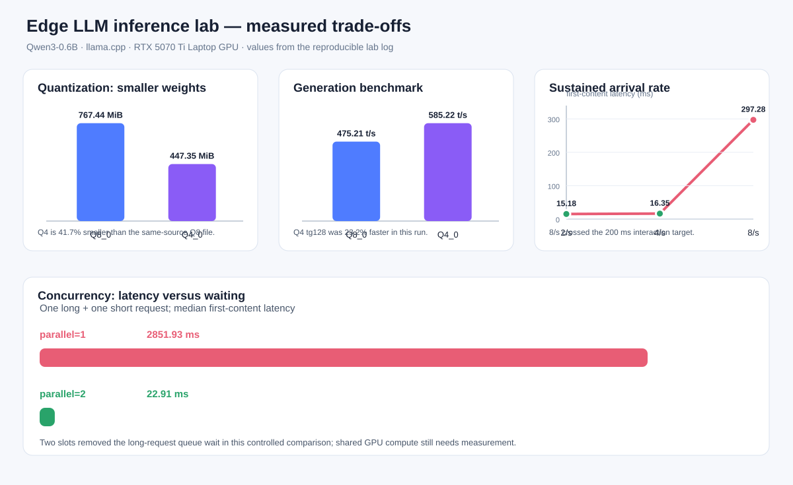
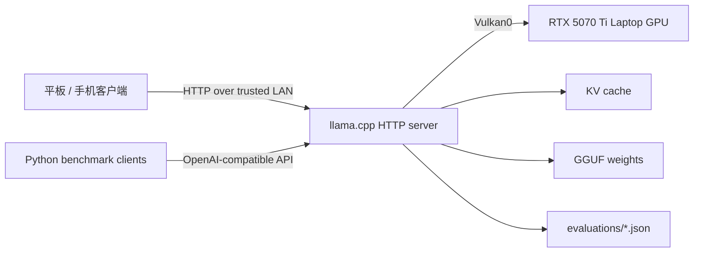

# 边缘电路问答助手：入门实验项目

一个基于 Qwen3 和 llama.cpp 的本地电路问答实验。笔记本运行模型，平板可通过局域网提问。项目用可重复的测试观察权重量化、KV Cache 和请求排队如何影响回答质量、缓存空间和交互延迟。



这是一个学习和测量项目，不是生产级电路助手。仓库重点记录“如何部署、如何测量、如何解释限制”，而不是把一次小样本结果包装成通用性能结论。

## 系统结构



端侧设备负责输入和显示，笔记本是边缘节点，模型推理和缓存都在笔记本完成。局域网实验只适用于可信网络；服务命令没有配置访问密码，也不应暴露到公网。

## 当前环境

Windows，Core Ultra 9 275HX，32 GB内存，RTX 5070 Ti Laptop 12 GB，Vulkan后端。Python 3.15.2；llama.cpp build12532/08c252e22。脚本仅使用Python标准库。

## 快速开始

安装 Python 和 [llama.cpp](https://github.com/ggml-org/llama.cpp)，确保 PowerShell 能运行 `python` 和 `llama-server`。从 [ggml-org 模型仓库](https://huggingface.co/ggml-org/Qwen3-0.6B-GGUF/tree/main) 下载 `Qwen3-0.6B-f16.gguf`，放到项目下新建的 `models` 文件夹。模型文件不随本仓库分发。

在项目目录运行：

```powershell
python -m venv .venv
llama-quantize "models\Qwen3-0.6B-f16.gguf" "models\Qwen3-0.6B-local-Q8_0.gguf" Q8_0 8
llama-server --list-devices
llama-server --model "models\Qwen3-0.6B-local-Q8_0.gguf" --device Vulkan0 --gpu-layers 99 --ctx-size 8192 --parallel 2 --cache-type-k q8_0 --cache-type-v q8_0 --host 127.0.0.1 --port 8080 --alias qwen-local-q8
```

`Vulkan0` 是本次实验的 NVIDIA GPU，请按 `--list-devices` 的结果选择本机设备。看到服务开始监听后，打开 [本机聊天页面](http://127.0.0.1:8080/)；可先用 [健康检查](http://127.0.0.1:8080/health) 确认加载完成。停止服务按 `Ctrl+C`。

用平板访问时，把 `--host` 改成运行服务的电脑在可信局域网中的 IPv4 地址，再让平板浏览器访问同一个地址的 `8080` 端口。此配置没有访问密码，仅用于可信局域网实验。

## 请求竞争实验

另开PowerShell，在项目目录执行：

```powershell
.\.venv\Scripts\python.exe queue_demo.py http://127.0.0.1:8080
.\.venv\Scripts\python.exe load_test.py http://127.0.0.1:8080 --concurrency 4
```

脚本先预热并测独立短请求，再让长请求与短请求竞争，保存首正文片段延迟、总耗时、完整回答以及测量前后的槽位配置。每轮写入evaluations下的新JSON。改变服务的--parallel并重启后，可重复比较；本轮单槽位和双槽位各5次。

`load_test.py` 用于发送 2、4 或 8 个同时到达的短请求，检测首段是否在 200 ms 内到达。使用局域网地址启动服务时，将这两个客户端命令的地址也改成对应的服务地址。

## 固定题目评测

batch_eval.py读取eval_questions.json，按固定生成配置测试三道开发题。评测客户端目前固定访问127.0.0.1:8080；使用前将服务--host设为127.0.0.1，或将脚本URL改为当前服务地址。停止旧服务后再启动替代服务。模型别名也要匹配。

```powershell
.\.venv\Scripts\python.exe batch_eval.py qwen-local-q8
```

完整请求和响应保存在evaluations/run_*.jsonl；通过与否由预设标准语义复核，不是关键词自动判分。ask*.py和client*.py为逐步学习时的示例，使用前检查其中URL和模型别名是否对应当前服务。

### 扩展到30题

新增 `eval_questions_v2.json`，六类各五题，覆盖单位、功率、网络、电容/节点、信息不足和错误前提。参考答案不发送给模型；系统提示词保持不变，生成上限统一512 token。脚本会保存题库SHA-256和服务配置。具体评分方案与限制见[质量评测方案](docs/quality_evaluation.md)。

```powershell
.\.venv\Scripts\python.exe batch_eval.py qwen-local-q8 --questions eval_questions_v2.json --max-tokens 512
```

可用 `--base-url http://实际服务地址:8080` 指定局域网服务，用 `--dry-run` 只验证题库。本轮经Codex逐题语义复核，**Q8为18/30、Q4为11/30**；含过程实质错误或前后矛盾的回答不通过。Q4有1题重复输出并达到长度上限。两版每题各一次，不代表总体正确率；完整条件、类别得分、逐题差异和限制见[30题对照报告](docs/results/quality_v2_comparison.md)。

另做了[提示词对照实验](docs/prompt_experiment.md)：Q4加入单位与独立核验提醒后，旧30题11→14分，但12道新题仍为5/12，并出现一次输出截断。默认提示词保留baseline，避免把开发题改善误认为总体提升。`--prompt-version checked`可复现试验版本；每轮保存提示词SHA-256及实际messages。

新增[计算模块与模型提取客户端](docs/calculator.md)：模型提供结构化参数，Python核对原文数值、单位、唯一性及可识别的对象分句后计算电流或电能。15项离线校验通过；规则无法识别所有对象别名，仍可能错配语义。Schema约束格式，不保证理解正确；当前仅验证少量开发例子，没有重新测定整体问答评分。

## 已观察到的结果

- 同源新Q4相比新Q8，文件体积减少约41.7%；固定tg128基准生成吞吐量提高约23.2%，不能直接当作聊天加速比。
- 三道开发题Q4/Q8都通过2道，不能代表整体质量等同。
- 8192-token上下文、Q8_0 K/V的GPU KV缓冲区实测476 MiB；缓冲区不等于进程总显存。
- 在本轮一长一短负载中，竞争短请求首正文延迟中位数：单槽位2851.93 ms，双槽位22.91 ms（各5轮）。本配置对比的每槽位上下文容量不同，且未随机化测试顺序。
- 双槽位、每轮 4 个同时到达的短请求，10 轮共 40 条：**38/40** 在 200 ms 内收到首段，**9/10** 轮四条全部达标。这是同一台机器和同一题目的突发测试。
- 固定到达速率实验中，2/s 和 4/s 的 20/20、40/40 请求都在 200 ms 内收到首段；8/s 仍完成 80/80，但只有 29/80 在 200 ms 内收到首段。

配置、复现步骤和统计见[实验报告](实验记录_量化对比.md)。报告中的原始日志文件名用于追溯本地记录；原始日志、模型权重和虚拟环境不收录到 Git。模型输出需要核对，尤其是信息不足和长解释题。

## 运行固定速率实验

服务启动后，可用下面的命令测量每秒 4 个请求的持续供给。`rate_test.py` 会按固定时间间隔提交请求，等待全部请求排空，并将完整记录写到本地 `evaluations/`（该目录被 `.gitignore` 排除）。

```powershell
.\.venv\Scripts\python.exe rate_test.py http://127.0.0.1:8080 --rate 4 --count 40 --max-tokens 256
```

改变 `--rate 2` 或 `--rate 8` 可复现本实验的低负载和过载边界。不同硬件、驱动、后台负载和模型版本需要重新测量。

## 项目文件

| 文件 | 用途 |
|---|---|
| `queue_demo.py` | 一长一短请求的槽位竞争实验 |
| `load_test.py` | 同时突发 2、4、8 个请求 |
| `rate_test.py` | 按固定到达速率持续发送请求 |
| `batch_eval.py` | 从 `eval_questions.json` 运行固定题目 |
| `实验记录_量化对比.md` | 完整实验数据、判断和限制 |
| `generate_figures.py` | 用摘要数据重新生成 README 图 |
| `docs/figures/performance_summary.svg` | GitHub README 展示图 |

## 许可证

本项目代码及配套文档采用 [MIT License](LICENSE)。Qwen 模型权重、llama.cpp 及其他外部依赖由各自的许可证约束；本仓库的 MIT 许可证不替代这些第三方许可证。模型权重不随仓库分发。
